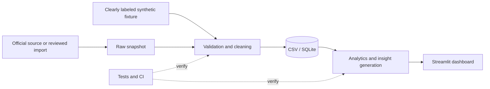
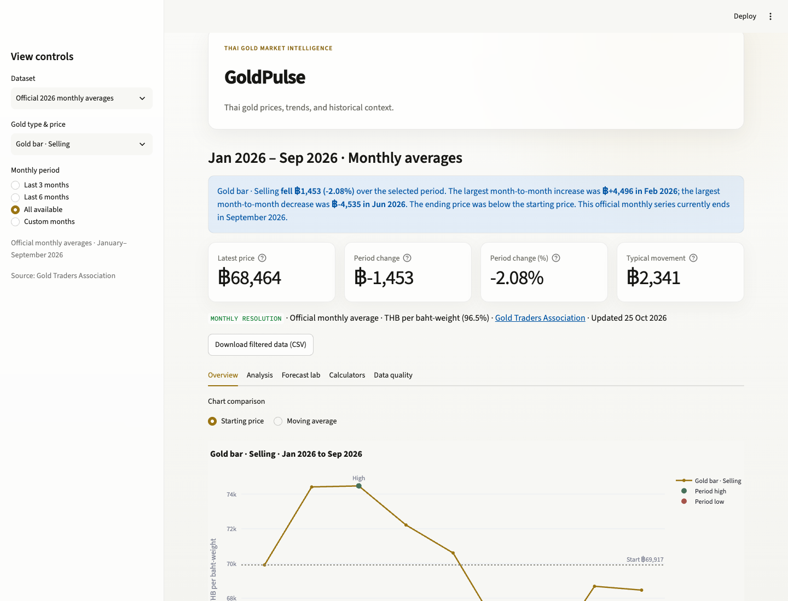
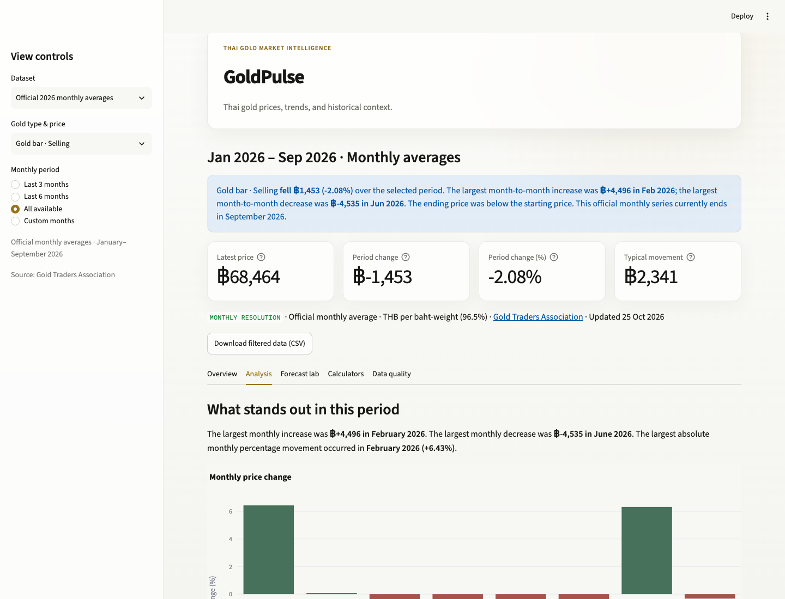
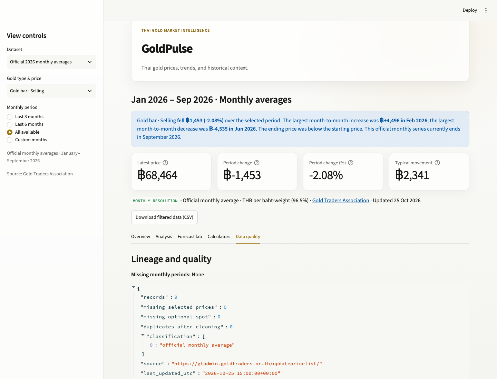

# GoldPulse

GoldPulse is a Streamlit analytics dashboard that turns Thai 96.5% gold reference prices into a concise, traceable story for retail users. It explains what changed, identifies the largest movements, compares the end of a selected period with its start, and keeps data-resolution and source limitations visible.

> This is an educational portfolio project, not investment advice. Official reference prices can differ from shop quotes, buy-back policies, fees, and workmanship charges.

## Case study

### The problem

Price tables alone make retail users do too much interpretation. GoldPulse was designed to answer four practical questions directly:

1. What happened during the selected period?
2. When were the largest increases and decreases?
3. How much did the price change from the start?
4. What data limitations affect the interpretation?

### My role

This project covers product scoping, data modeling, validation, analytical calculations, responsible narrative generation, dashboard design, testing, and documentation. The design deliberately separates official monthly reference data from synthetic daily demonstration data.

### Data and resolution

- **Official reference series:** Gold Traders Association monthly averages for January–September 2026. These are monthly observations and are never presented, expanded, or interpolated as daily prices.
- **Synthetic demo series:** deterministic 2025 daily-format observations used only to demonstrate daily analysis and forecasting. Every synthetic record is labeled `synthetic_demo` in the data and interface.
- **Market context:** dated source links shown only when they fall within the selected analysis period. Context and correlation are not treated as proof of causation.

The official and synthetic series remain separate throughout the application. Shop-specific quotes are not included or mixed with official reference prices.

### What the product does

- Generates a filter-aware plain-language summary and meaningful KPIs
- Marks period highs and lows and visualizes consecutive-period changes
- Uses month-level controls and month-to-month calculations for official data
- Reports missing periods rather than silently filling them
- Provides monthly summaries, supporting-variable analysis, and guarded calculators
- Includes a chronological naive-versus-Ridge forecasting demonstration for synthetic daily data only
- Preserves source, collection timestamp, and data-status metadata

### Findings in the included official snapshot

For the **gold bar selling monthly average** from January through September 2026:

- The average moved from **฿69,916.67** to **฿68,464.00**, a change of **−฿1,452.67 (−2.08%)**.
- The highest included monthly average was **฿74,471.15 in March**; the lowest was **฿64,603.57 in July**.
- The largest consecutive-month rise was **+฿4,495.83 in February** and the largest fall was **−฿4,534.62 in June**.

These findings describe only the checked-in snapshot and selected series. The dashboard recalculates findings for every filter selection; it does not hard-code conclusions into the interface.

### Validation and responsible analysis

The pipeline validates required fields and price relationships, rejects invalid rows, deduplicates on the natural announcement key, and retains the newest collected version. Forecast evaluation is chronological rather than randomly shuffled. The dashboard avoids causal claims, suppresses misleading charts when data is insufficient, and exposes resolution, source, status, gaps, and last-updated metadata.

## Architecture



See [docs/ARCHITECTURE.md](docs/ARCHITECTURE.md) for component boundaries, lineage, and deployment flow. Product requirements and the data dictionary are in [docs/PROJECT_SPEC.md](docs/PROJECT_SPEC.md).

The [accessibility review](docs/ACCESSIBILITY.md) records contrast checks, keyboard and screen-reader verification steps, reduced-motion support, and remaining manual checks. The [official daily-data audit](docs/DAILY_DATA_AUDIT.md) documents why real daily forecasting is not enabled without a permitted source.

## Screenshots

These images were captured from the running application at a 1440 × 1100 laptop viewport.







## Run locally

Requires Python 3.11+.

```bash
python -m venv .venv
source .venv/bin/activate
python -m pip install -r requirements.txt
streamlit run app.py
```

The official monthly snapshot is the primary real-data view. Generating demo data is optional:

```bash
python scripts/generate_sample_data.py
```

## Test

```bash
python -m pytest -q
```

CI runs the same test suite on Python 3.11 and 3.12 for pushes and pull requests.

## Deploy

For Streamlit Community Cloud:

1. Push the repository to GitHub.
2. Create an app at Streamlit Community Cloud and select `app.py` as the entry point.
3. Use Python 3.11+ and install from `requirements.txt`.
4. Do not add secrets unless a reviewed source adapter requires them; never commit `.streamlit/secrets.toml`.
5. After deployment, verify the official-data badge, monthly labels, source links, calculator empty states, and mobile/laptop layouts.

The checked-in `.streamlit/config.toml` supplies the light theme and headless server setting. The app does not require a database or external network call to start.

## Repository map

```text
app.py                          Streamlit application
goldpulse/cleaning.py           validation and daily aggregation
goldpulse/forecast.py           time-ordered model evaluation
goldpulse/storage.py            SQLite schema and idempotent upsert
scripts/collect.py              opt-in, robots-aware fetch scaffold
scripts/build_official_dataset.py reproducible official snapshot build
scripts/generate_sample_data.py deterministic synthetic fixture
data/raw/gta_monthly_averages_2026.csv reviewed raw monthly snapshot
data/official_2026_monthly.csv  official monthly-average snapshot
data/official_2026_monthly.provenance.json build metadata and checksum
data/market_context_2026.csv    dated context with source links
data/sample_gold_prices.csv     synthetic daily-format demo
docs/ARCHITECTURE.md            system design and data lineage
docs/DATA_PROVENANCE.md         official snapshot provenance contract
docs/PROJECT_SPEC.md            requirements, dictionary, and policy
tests/                           automated behavior checks
```

## Reproducibility and dependency policy

`requirements.txt` uses bounded direct dependencies for local and hosted setup. `requirements-lock.txt` records the exact direct versions used in the verified development environment. Review dependency updates through pull requests and keep automated tests as the compatibility gate.

Rebuild the official clean dataset and provenance report with `python scripts/build_official_dataset.py`. The reviewed raw monthly snapshot is intentionally checked in so the build is reproducible. Live collection remains opt-in: before using `scripts/collect.py`, review the current source terms, `robots.txt`, licensing, and permitted request pattern. Never bypass access controls.

## Limitations

- The official snapshot contains nine monthly averages, not daily prices or complete intramonth ranges.
- The checked-in official build starts from a reviewed raw monthly snapshot rather than making an unattended live request. Source changes still require a new review and adapter update.
- `accessed_at` documents retrieval, not the time of an underlying market announcement.
- Spot and FX series can have different market calendars and timestamps; correlation does not establish causation.
- The synthetic daily series cannot support claims about the real market, and its forecast is a methodology demonstration only.
- Reference prices exclude shop-specific workmanship fees, transaction costs, inventory constraints, and exact buy-back policies.

## Next steps

1. Publish the prepared app to a portfolio-owned Streamlit Community Cloud account.
2. Complete the documented manual screen-reader checks on the hosted build.
3. Re-audit official daily history if a documented API, licensed export, or written permission becomes available.

## License

Released under the [MIT License](LICENSE).
