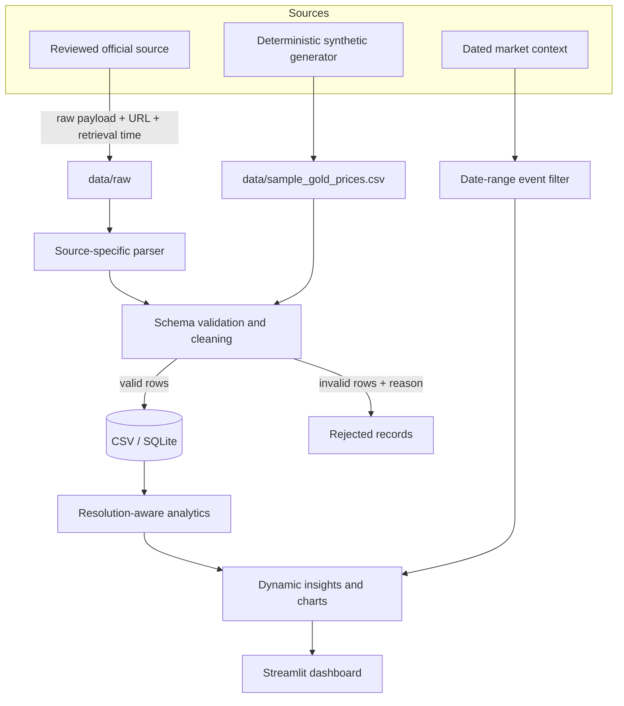
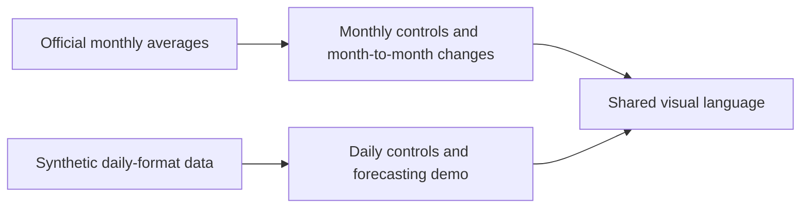

# GoldPulse architecture

## Design goals

GoldPulse prioritizes traceability, honest resolution, deterministic transformations, and clear separation between official reference data and demonstration data. The application must remain useful offline and must not manufacture observations when dates are missing.

## Data flow

The source-specific parser is a documented production target. The included collector intentionally stores payloads without guessing a changing website schema.

## Component responsibilities

| Component | Responsibility |
|---|---|
| `scripts/collect.py` | Perform one reviewed, robots-aware fetch and preserve an untouched payload with provenance |
| `scripts/generate_sample_data.py` | Produce a deterministic synthetic fixture for offline feature demonstration |
| `goldpulse/schema.py` | Define canonical analytical fields |
| `goldpulse/cleaning.py` | Validate, reject invalid values, deduplicate, and derive daily close data |
| `goldpulse/storage.py` | Persist validated observations with idempotent SQLite upserts |
| `goldpulse/forecast.py` | Evaluate the naive and Ridge approaches with chronological holdout data |
| `app.py` | Select resolution-aware analysis, calculate narratives, render charts, and expose provenance |

## Dataset boundaries

The two paths share presentation conventions but not observations. Official monthly values are never forward-filled, interpolated, or expanded into daily rows. Shop-specific quotes require a separate status and source path before they can be introduced.

## Calculation contract

- Period change is the final selected observation minus the first selected observation.
- Percentage change uses the first selected observation as the denominator.
- Official movement is calculated only between consecutive available monthly observations.
- The first selected month has no prior-period movement.
- Volatility or typical movement is labeled according to the active dataset's resolution.
- A missing or insufficient series produces an explanatory state instead of a blank or oversized chart.
- Event context is filtered to the selected period and is not described as causal evidence.

## Quality and lineage

Every analytical record carries a source identifier, retrieval timestamp, and status. Valid records and rejected records remain distinguishable. Missing periods remain missing. The expected future official-data workflow is:

1. Save an immutable source response in `data/raw/`.
2. Parse it with a source-specific adapter.
3. Validate types, required values, price relationships, dates, and status.
4. Record rejected rows and reasons.
5. Publish a cleaned snapshot and row-count reconciliation.
6. Run tests before deployment.

## Deployment

The application is stateless for the included snapshots and starts without network access. Streamlit reads the versioned CSV files and theme configuration directly. CI tests supported Python versions before changes are merged. A hosted deployment should pin a Python runtime, install `requirements.txt`, avoid committed secrets, and be smoke-tested against both official and synthetic modes.

## Trust boundaries

- External payloads are untrusted until parsed and validated.
- Source access must comply with current terms, robots rules, licensing, and rate limits.
- Market context can support interpretation but cannot prove why a price moved.
- Forecasts remain isolated from official monthly analysis until adequate permitted real daily history exists.
